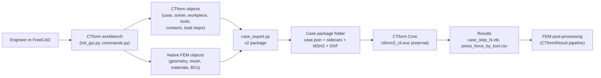
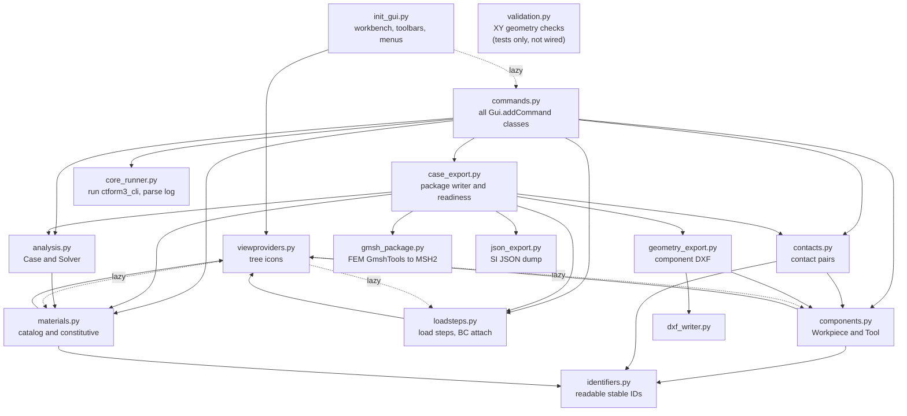
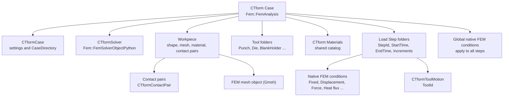
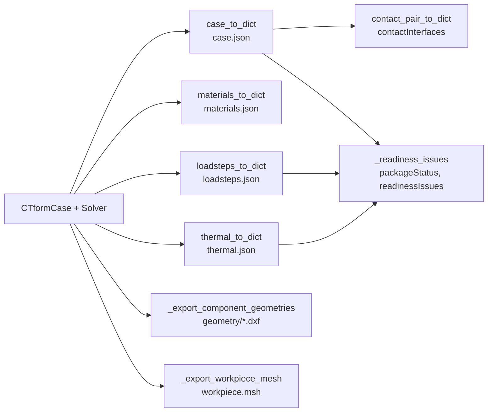
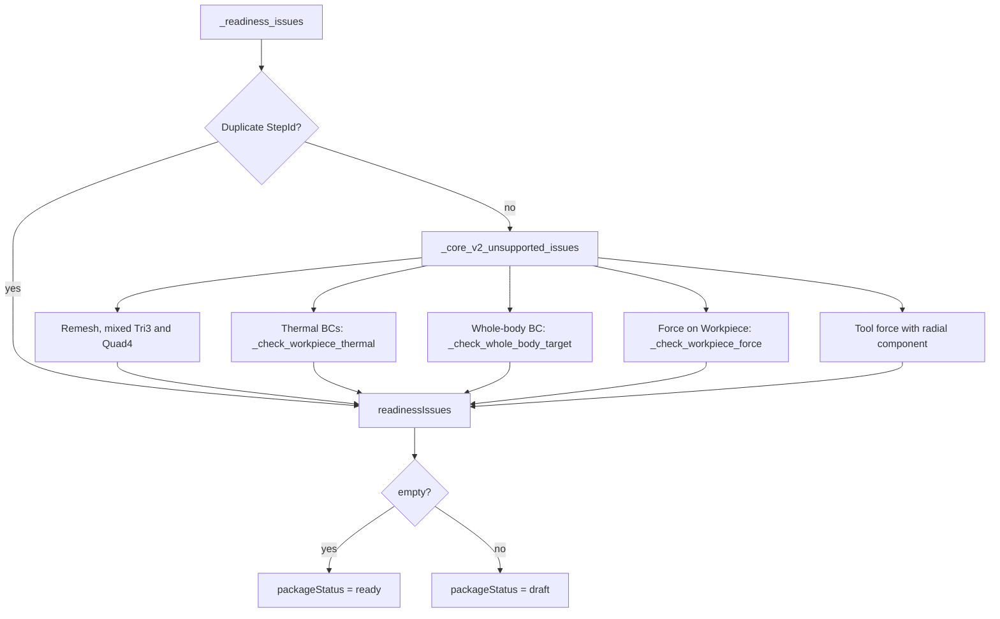
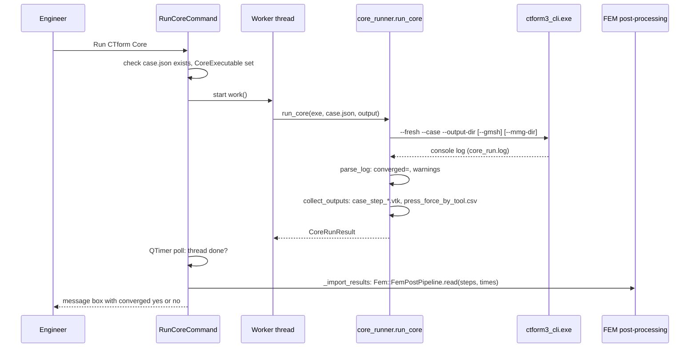
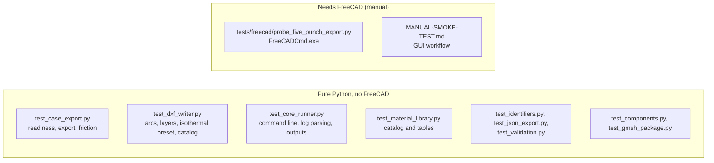

# CTform FreeCAD Interface: developer guide

A map of the addon for the next developer. It explains how the pieces fit,
where each responsibility lives and how to make the usual changes. Rules and
decisions stay in `DEVELOPMENT-CONTEXT.md`; the Core contract stays in
`Core-Refactor.md`; current state stays in `STATUS.md`. This file explains the
code; it does not replace those.

Diagrams use Mermaid, which GitHub renders.

## 1. What the addon does

The addon is a FreeCAD 1.1 workbench. It builds a case in FreeCAD's native FEM
workbench, exports a v2 case package for CTform Core, and runs Core on it. Core
is a separate, proprietary executable. It is not in this repository and its
source must not be copied here.



## 2. Module map

Package: `freecad/CTformFreeCADInterface/`. The arrows show module imports
(function-level imports are included, and they are the only cycle breaker).



| Module | Responsibility |
| --- | --- |
| `init_gui.py` | Registers the `CTformFreeCADInterfaceWorkbench`, toolbars and menus. |
| `commands.py` | One class per GUI command, registered with `Gui.addCommand`. |
| `analysis.py` | `CTformCase` (`CTform Case` container) and `CTformSolver` (modelling, numerics, run settings), `apply_isothermal_preset`. |
| `components.py` | Workpiece and Tool folders: shape, mesh, material link, stable `ToolId`. |
| `contacts.py` | Visible contact pairs; `contact_pair_to_dict` writes `contactInterfaces[]`. |
| `loadsteps.py` | Load-step groups that own native FEM conditions; tool motions; attach/detach/clone. |
| `materials.py` | Shared catalog, import of `materials.json`, constitutive parameters, readiness of tables. |
| `case_export.py` | Writes the whole package and the readiness list. The largest module (about 1,160 lines). |
| `geometry_export.py` | Component profile to ASCII DXF (mm to m, layers `EdgeN`). |
| `dxf_writer.py` | Own DXF writer: exact LINE/ARC/CIRCLE. Replaces FreeCAD's exporter, which turns short arcs into circles. |
| `gmsh_package.py` | Saves the FEM Gmsh run as MSH2 for Core, keeps physical group IDs. |
| `core_runner.py` | Builds the Core command line, runs it, parses `converged=` and warnings, lists outputs. No FreeCAD imports. |
| `viewproviders.py` | Tree icons. Imports its targets lazily to avoid a cycle. |
| `identifiers.py` | `readable_id`: slugs with numeric suffixes, stable across label changes. |
| `json_export.py` | `dumps_si`, used only by `case_export.py`. |
| `validation.py` | Initial XY-plane geometry checks. Only the tests import it; reserved for the preflight in `STATUS.md` (Next, item 4). |
| `misc/resources.py` | Icon lookup helper. |

## 3. FEM object tree

Everything hangs under one `Fem::FemAnalysis` (`CTform Case`). CTform folders
are `App::DocumentObjectGroupPython` or `Fem::FemSolverObjectPython` proxies;
the FEM conditions and the mesh are native FreeCAD objects.



Rules that the code enforces (keep them when you change it):

- One case per document (`CreateCaseCommand`).
- Solver owns modelling dimension, formulation, numerics, initial temperatures and run options. Case stays neutral.
- Materials live once in `CTform Materials`; components link to them.
- Forces apply only to Tools. A Force on the Workpiece is a readiness error and is never exported (`_check_workpiece_force`).
- A condition is either global (analysis root) or attached to one load step.

## 4. Export pipeline

`case_export.write_case_json(case, folder)` writes the package. Each file is
produced by one function.



Package layout (schema v2, `case.json` `schemaVersion: 2`):

```text
<case folder>/
  case.json            top level: units, simulation, geometry, mesh, contact,
                       contactInterfaces, conditionPrecedence, output, run, ale,
                       remesh, solver, packageStatus, readinessIssues
  materials.json       constitutive, elastic, thermal per material
  thermal.json         initialTemperature {workpiece, tools} and thermalBCs
  loadsteps.json       loadSteps[] with tools[] (id, toolId), mechanicalBCs,
                       thermalBCs, warnings
  workpiece.msh        Gmsh MSH2 with physical groups
  geometry/workpiece.dxf
  geometry/tools/*.dxf
```

Coordinates: FreeCAD sketch X is radial r and sketch Y is axial z for
axisymmetric cases. Core's DXF and MSH use metres.

### Readiness

`packageStatus` is `ready` only when `readinessIssues` is empty. Each rule is a
function that appends a message; the export still writes the package when there
are issues, so you can inspect it.



## 5. Run and results

`RunCoreCommand` runs Core on a worker thread so the GUI stays responsive. A
`QTimer` polls the thread once a second and reports the result.



Output names come from Core's source (`CTF3/Run/OutputSetup.cpp`):
`case_step_<n>.vtk`, and the CSV header is `Step,Time,Tool,Force`.

## 6. Core contract and ownership

| Topic | Owner | Where it is written down |
| --- | --- | --- |
| Package schema, stable IDs, physical groups | Shared contract | `Core-Refactor.md` |
| Solver numerics, time stepping, penalty handling | Core | Core `STATUS.md` |
| Export rules, readiness, FreeCAD UI | Addon | this file, `DEVELOPMENT-CONTEXT.md` |
| Five-punch validation, thesis values | Thesis | thesis repo (read-only for addon work) |

Things the addon knows that Core does not yet use or accept:

- `contactInterfaces[].normal.penalty` (exported when a pair's `Penalty` is above 0). Core v2 drops it.
- Core's flow formulation does not constrain the r = 0 axis. The addon must
  place a radial displacement of 0 on the axis edge. The probe does this.
- A BC without a physical group or target applies to every node. Readiness
  flags mechanical and surface thermal BCs that are not tied to an edge.
- Tool motion is z-only. Radial tool force is a readiness issue.
- Friction at the first contact aborts the five-punch case (`line_search_failed_all_lambdas`). This is Core issue C-M1.

## 7. Tests

Run `python -m unittest discover -s tests` (pytest is not installed). No unit
test imports FreeCAD.



The tests use `SimpleNamespace` stand-ins for FreeCAD objects. They check the
rules, not FreeCAD's behaviour. Interactive behaviour (commands, icons, the Run
command, reloading old documents) is covered only by the probe and the manual
smoke test. Check it in FreeCAD after every change to `commands.py`,
`viewproviders.py` or `init_gui.py`.

Headless probe for the five-punch case:

```text
set CTFORM_PROBE_OUT=C:\temp\probe
FreeCADCmd.exe tests\freecad\probe_five_punch_export.py
```

Optional switches: `CTFORM_PROBE_PUNCH_GAP` (mm), `CTFORM_PROBE_MU` (0 exports
friction `none`), `CTFORM_PROBE_NO_HOLDER`, `CTFORM_PROBE_NO_AXIS`,
`CTFORM_PROBE_INCREMENTS`.

## 8. Recipes

### Add a Solver property that is exported

1. Add it in `analysis.py` (`CTformSolver._add_properties`, using `_add`).
2. Read it in `case_export.case_to_dict` (or `thermal_to_dict`) with `_value(solver, name, default)`.
3. Add a test in `tests/test_case_export.py` that reads the value from a `SimpleNamespace` solver.
4. If Core needs it, update `Core-Refactor.md` first.

### Add a readiness rule

1. Write a `_check_...(condition, case, ..., issues)` function in `case_export.py`
   that appends a message. Keep the message in plain English and say what to change.
2. Call it from `_core_v2_unsupported_issues` (for load-step and root conditions).
3. Add a `SimpleNamespace`-based test next to the existing `_targets_case` tests.
4. Update `STATUS.md`.

### Add a GUI command

1. Create a class in `commands.py` with `GetResources`, `IsActive` and `Activated`.
2. Register it with `Gui.addCommand("CTform_<Name>", ...)` at the bottom of `commands.py`.
3. Add it to the toolbar and menu lists in `init_gui.py`.
4. Test it in FreeCAD. Restart FreeCAD after changing `init_gui.py`.

### Map a native FEM condition type to Core

1. Find the type in `case_export._condition_to_dict` (mechanical) or the thermal branch.
2. Check that a whole-body target is allowed or rejected in `_check_whole_body_target`.
3. Add a test with a `SimpleNamespace` condition whose `TypeId` matches the FEM object.

## 9. Review findings (2026-10-30)

Code review on `main` at `d965fc0`. Severity is for the addon only. Items 1 to 4
are in the Run command and have not been exercised on real Core output, because
no five-punch run has converged yet.

| # | File:line | Severity | Finding |
| --- | --- | --- | --- |
| 1 | `commands.py:430,476` | Medium | The worker catches only `OSError` and `ValueError`. Any other exception ends the thread with no `result` key, and `_report` then raises `KeyError: 'result'`. Catch `Exception` in `work()`, or store the error in both branches. |
| 2 | `commands.py:449-470` | Medium | `_import_results` is called from the QTimer callback with no `try`. A failure in `pipeline.read` shows as a Python traceback and the message box never appears. |
| 3 | `commands.py:377-447` | Medium | There is no guard against starting a second run while one is active. Two Core processes would write the same output folder. Disable the command or check `self._timer` first. |
| 4 | `core_runner.py:113` | Low | `run_core` is called without a timeout, so a hung Core cannot be stopped from the GUI. The docstring and `CoreRunResult.timed_out` describe a timeout path that the command never uses. |
| 5 | `commands.py:765` | Low | `CTform_CreateAnalysis` aliases `CreateCaseCommand`, is not in any menu and is not used. Remove it unless something external calls it. |
| 6 | `contacts.py:134`, `case_export.py:1155` | Low | `_length_to_si` is duplicated (the two copies are identical; plain numbers are read as mm). The `_add` helper is duplicated in five modules (`analysis`, `components`, `contacts`, `loadsteps`, `materials`). Move both to one helper module. |
| 7 | `validation.py` | Info | Only the tests import it. Either wire it into the preflight or delete it. |
| 8 | `DEVELOPMENT-CONTEXT.md` | Doc | "Current validation" still says 48 tests (the count is 81). The 2026-10-18 handoff says initial temperatures were removed and thermal BCs are out of scope; both are superseded (see `STATUS.md`). |
| 9 | `STATUS.md` (In progress) | Doc | Says `agent/core-thermal-force-sync` must wait for Core `agent/v2-thermal-bcs`. That branch is merged into `main` and Core `master` has the v2 reader at `08e9ac4`. Confirm with the author before rewriting this. |
| 10 | `core_runner.py:86` | Verified | VTK naming and CSV columns match Core source (`CTF3/Run/OutputSetup.cpp`) and the probe3 CSV header. The import path itself has not run on real output. |

Suggested order: fix 1 and 2 together (one small change in `commands.py`), then 3,
then the duplicates in 6. Items 8 and 9 need the author's confirmation of current state.

## 10. Where to start

1. Read `AGENTS.md`, then `STATUS.md`.
2. Read `DEVELOPMENT-CONTEXT.md` for the design rules and `Core-Refactor.md` for the Core contract.
3. Run the unit tests and the probe to see a working export.
4. Open `case_export.py` at `case_to_dict` and follow it through the diagrams above.
