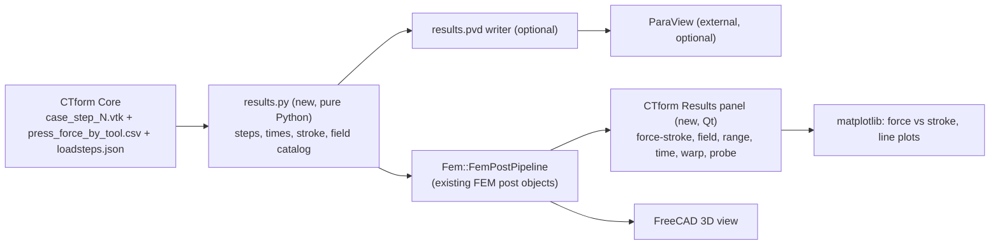

# Results visualization plan

Goal: show CTform Core results inside the CTform workbench, built on the FEM
post-processing tools FreeCAD already has. The target is a results panel with the
interactions a ParaView user expects (field selection, colour bar with range control,
time slider, warp, clip/cut, probes, plots, screenshots), organised around what the
thesis compares with Nunes 2025.

This is a plan, not an implementation. Nothing here changes Core. Status and
decisions are tracked in `STATUS.md`.

## 0. Decisions

- **Panel inside FreeCAD** is the main deliverable (2026-10-30, author).
- **Viewport:** the FreeCAD 3D view with the FEM post objects. No embedded VTK window.
- **View:** the 2D meridian is enough. No full-body (revolved) 3D view.
- **ParaView:** optional. "Export for ParaView" is kept because it is cheap; it comes last.
- **Thesis fields and quantities:** answered by Thay (§3). Thay's answer is information
  only; it is not a change request for Core or the thesis.

## 1. What Core gives us (verified in Core source)

Each converged step is written as `case_step_<n>[suffix].vtk`, legacy ASCII VTK 3.0,
`DATASET UNSTRUCTURED_GRID`, header `CTForm3 - Multibody Results`
(`CTF3/IO/VTKWriter.cpp`). ParaView and FreeCAD's VTK 9.3.1 read it without conversion.

| Data | Name in file | Association | Type |
| --- | --- | --- | --- |
| Equivalent plastic strain | `Plastic_Strain` | cell | scalar |
| Von Mises stress | `VonMises_Stress` | cell | scalar |
| Mean stress (see §3) | `Pressure` | cell | scalar |
| Full stress | `SIGMAT` | cell | tensor (3x3) |
| Full strain | `EPS` | cell | tensor |
| Strain rate | `Strain_Rate` | cell | scalar |
| Plastic work | `Plastic_Work` | cell | scalar |
| Element temperature | `Temperature` | cell | scalar (element mean) |
| Generated heat | `Generated_Heat` | cell | scalar |
| Element type | `element_type` | cell | int (10 = tool) |
| Displacement | `Displacement` | point | vector |
| Nodal temperature | `Temperature_Nodal` | point | scalar |
| Contact fields | `ContactPressure`, `ContactNormalForce`, `ContactPenetration`, `ContactShearStress`, `ContactSticking`, `ContactTotalSlip`, `ContactActive`, `ContactLambda`, `ClosestToolId`, `ClosestInterfaceId`, `ToolSignedGap`, `ToolSurfaceDistance` | point | scalar |
| Tool motion | `VelocityIncrement`, `VelocityPhysical`, `ClosestToolPoint`, `ClosestToolNormal` | point | vector |

Tool cells are in the same file with zero values, so a field colours the punch and
die as well (zero) unless the view hides them.

Time and force come from `press_force_by_tool.csv` (`Step,Time,Tool,Force`, one row per
step per tool), read by `collect_outputs` and `step_times` in `core_runner.py`. Step
numbers come from the file name. With `VtkEvery > 1` fewer files are written; the time
mapping must use the CSV step number, not the file index.

## 2. What FreeCAD already provides (checked 2026-10-30)

- `Fem::FemPostPipeline` reads a series of VTK files with a time per file
  (`read(files, times, unit, "Time")`), as `RunCoreCommand` already does.
- Filters in this FreeCAD 1.1 install: Clip (`FemPostClipFilter`), Cut
  (`FemPostCutFilter`), Scalar clip (`FemPostScalarClipFilter`), Warp
  (`FemPostWarpVectorFilter`), Contours (`FemPostContoursFilter`), Data along line
  (`FemPostDataAlongLineFilter`), Data at point (`FemPostDataAtPointFilter`), Function
  (`FemPostFunction`), Glyph, Histogram, Line plot and Table (`ObjectsFem.makePost*`).
- Python has VTK 9.3.1 (`vtkmodules`) and matplotlib. Qt is PySide; `QtCharts` is not
  available, so plots use matplotlib.
- ParaView is not installed on this PC.

## 3. What the panel must show (from Thay, thesis comparison with Nunes 2025)

Plotted, not a VTK field, and first in the panel:

0. **Punch force vs punch stroke**, full-ring force. This is the validation quantity:
   Nunes Figs 37, 38 and 40 compare experiment with QForm per blank diameter. Also
   blank-holder force vs stroke (should stay at the constant target: a servo check) and
   die force vs stroke (equilibrium check: die = punch + holder). The thesis figures and
   metrics come from `tools/compare_force.py` in the thesis repo; the viewer plot is a
   convenience view of Core's per-tool force output.

   **Stroke** is measured from the punch's first contact with the sheet, not from
   t = 0. The start of contact is not in the CSV directly; the plan derives it in
   phase 1 (first step with punch force > 0, or `ContactActive` in the VTK), and checks
   it against the prescribed motion (`loadsteps.json`, punch velocity 19.5 mm/s in the
   probes). The placeholder initial gap (1 mm) must be subtracted, so the check matters.

VTK fields, in order:

1. `Plastic_Strain` (equivalent plastic strain). Default colour field. The viewer
   shows the maximum and its location for each step (Nunes Figs 36, 39, 41: maximum
   equivalent strain per punch).
2. `VonMises_Stress` (same figures; for example 1016 MPa maximum on the hemispherical punch, 110 mm).
3. `Pressure`, labelled in the legend as **mean stress** (see note below).
4. Deformed shape at the end of the stroke, meridian view, shown next to the fields
   (Warp by `Displacement`).
5. `Temperature`: only to confirm that the isothermal case stays at 293.15 K (C-M4).
   Not shown in the thesis; keep it available but not in the default list.
6. `ContactPressure` and `ContactSticking`: diagnostic (for example the pressure under
   the blank holder). Low priority.

Optional, if cheap: thickness along the meridian (derived from the geometry, for the
thinning and rupture discussion). Principal strains from `EPS` only if forming-limit
points are planned (not planned yet).

Not needed: `Plastic_Work`, `Generated_Heat`, `Strain_Rate` (debug only), `SIGMAT` and
`EPS` as raw tensors.

**Note on `Pressure` (checked in Core source):** the value written is the mean of the
diagonal stress terms, (σ₀ + σ₁ + σ₂)/3, computed in
`TriangleDeformableElement.cpp` (lines 134 and 205). The sign is the stress sign:
tension positive, so compression gives negative values. The legend must say "mean
stress σm = (σrr+σzz+σθθ)/3, tension positive", not "pressure". Confirm the sign and
the three terms on a converged run in phase 0 (the sheet is Tri3, so the triangle
element is the one that matters).

**Time slider:** label each step with the punch stroke in mm as well as time, since
every comparison with Nunes is against stroke.

## 4. Feature map: panel → implementation

| Panel feature | Existing FreeCAD piece | Gap to fill |
| --- | --- | --- |
| Force-stroke plot (punch, holder, die) | none (CSV) | Matplotlib canvas; stroke from first contact; click moves the slider. |
| Field selector | Post pipeline `Field` property | Catalog with units and the order in §3. |
| Colour bar and range | FEM colour bar | Range control per field; keep the range between steps; show max and location. |
| Time slider | Post pipeline time | Labels with time and punch stroke (mm). |
| Warp by displacement | `FemPostWarpVectorFilter` | Scale slider. |
| Clip / cut | `FemPostClipFilter`, `FemPostCutFilter` | Plane presets for the meridian. |
| Probe at point | `FemPostDataAtPointFilter` | Show the values in the panel. |
| Line plot over meridian | `FemPostDataAlongLineFilter` | Matplotlib plot in the panel. |
| Spreadsheet | `ObjectsFem.makePostTable` | CSV export per step. |
| Screenshot | FreeCAD "Save image" | Command with a fixed size and background. |
| Export for ParaView | none | `results.pvd` series (optional). |

## 5. Architecture

Principles:

- The FEM post objects stay the single source of what is shown. The panel sets their
  properties; it does not keep its own copy of the data.
- `results.py` has no FreeCAD imports. It reads the case folder and returns plain data,
  so it can be tested with a fixture (§7). The stroke calculation lives there.
- Core is read-only input. No Core change is needed.

## 6. Phases

Sizes are rough (S: a few hours, M: a few days, L: more than a week) and assume one
developer.

### Phase 0: spike (S), next

- Fixture generator (no FreeCAD) that writes `case_step_N.vtk` in Core's layout on the
  mesh of a probe package, with synthetic fields for two or three steps, and a matching
  `press_force_by_tool.csv`. It goes in `tests/fixtures/`.
- In FreeCAD, open the fixture with `FemPostPipeline` and check: which fields the
  `Field` list offers (point data only, or cell data too); whether tensor fields load;
  how the time mapping behaves; load time for the 1,920-element sheet.
- If the pipeline offers only point data, add VTK's `CellDataToPointData` in the loader
  (in the pipeline, not in Core) or read cell fields with our own reader.
- Confirm the `Pressure` terms and sign on a converged run (or record that no converged
  run exists yet).
- Record the result in `DEVELOPMENT-CONTEXT.md`.

Acceptance: a short note with the field list the pipeline shows for the fixture, and the
`Pressure` note confirmed or marked open.

### Phase 1: force-stroke plot and panel core (M)

- Stroke from first contact (§3, item 0), computed in `results.py`, with the check
  against the prescribed punch motion.
- Matplotlib canvas: punch, blank holder and die force vs stroke from the CSV. The
  current step is marked. Clicking a point moves the time slider.
- Qt task panel (or dock widget): field selector (default `Plastic_Strain`, then
  `VonMises_Stress`, `Pressure` as mean stress), range (auto or manual, reset), time
  slider labelled with time and stroke, warp scale, show/hide tools, export button.
- Save and restore the panel state on the case (a result object property).

Acceptance: the force-stroke plot matches the CSV; stroke at the first contact equals
the prescribed motion minus the initial gap; switching field, time and warp updates
the FreeCAD view without a recompute.

### Phase 2: probe, line plot and maximum (M)

- Probe: enter coordinates or pick a node; show the values of the fields at the nearest
  node or element (`FemPostDataAtPointFilter`).
- Line plot along the meridian (`FemPostDataAlongLineFilter`) for a chosen field.
- Maximum per step for the default fields, with its location (Nunes comparison).

Acceptance: a probe at a known node returns the value read directly from the VTK file;
the maximum of `Plastic_Strain` per step matches a direct read of the file.

### Phase 3: export (S)

- Screenshot command at a given size; CSV export of the force-stroke data, probe and
  line values, and per-step maxima.

Acceptance: exported CSV values match the panel.

### Phase 4: Export for ParaView (S, optional)

- Command writes `results.pvd` (ParaView collection listing each `.vtk` with its time)
  next to the step files. Only if the team uses ParaView.

Acceptance: the same run opens in FreeCAD and in ParaView with the same time steps and
the same maximum `Plastic_Strain`.

### Phase 5: thickness and multi-run comparison (later)

- Thickness along the meridian (optional, from geometry).
- Two runs side by side, same field and range, same time mapping. Only after phases 0–3.

Not planned: a full-body (revolved) 3D view; principal strains and forming-limit points.

## 7. Tests

- Unit tests (no FreeCAD, `unittest`): `results.py` reads the fixture folder, returns
  steps sorted by number, times from the CSV, stroke from first contact, the field
  catalog with units, the per-step maxima, and the `.pvd` text. The fixture is small and
  checked in.
- FreeCAD probe (manual, like `tests/freecad/probe_five_punch_export.py`): opens the
  fixture or a real run, builds the pipeline, prints the field list and value ranges.
- Manual checklist with screenshots for the GUI (force-stroke plot, slider, probe,
  export).

## 8. Risks and open questions

Risks:

- **No converged output yet.** Five-punch runs abort at first contact (Core task C-M1).
  Use a case that converges (for example the SmokeTest package) for phases 0–2 until
  C-M1 is solved. The force-stroke validation itself needs C-M1 solved.
- **Stroke origin.** The first-contact definition must match what the thesis uses. Ask
  Thay to confirm the definition if the check in phase 1 disagrees with the prescribed
  motion.
- **Cell vs point data** in the FEM pipeline; checked in phase 0 with the fallback in §6.
- **Large meshes.** The five-punch sheet is 1,920 Tri3 elements; a real run with
  refinement and several tools could be much larger. Measure in phase 0.
- **VTK version.** FreeCAD ships VTK 9.3.1; ParaView ships its own. Keep to standard
  legacy VTK so both read the same files.
- **Several cases per document.** Results are keyed to the case, not to the active
  document.

Open:

1. ParaView on the team's machines (phase 4 depends on it; the author said it is fine
   to use if it helps).
2. Confirm the `Pressure` sign and terms on a converged run (phase 0).

## 9. Next steps

1. Phase 0 spike: fixture generator and pipeline check.
2. Phase 1: force-stroke plot and panel core.
3. Phases 2 and 3; phase 4 if ParaView is used.
