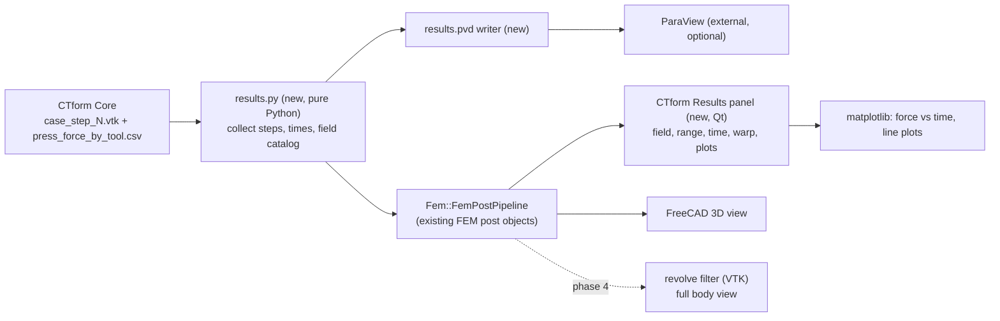

# Results visualization plan

Goal: show CTform Core results inside the CTform workbench, starting from the
FEM post-processing tools that FreeCAD already has, and reach the kind of view a
ParaView user expects: field selection, a colour bar with range control, a time
slider over load steps, warp, clip/cut, probes, plots and screenshots.

This is a plan, not an implementation. Nothing here changes Core. Status and
decisions are tracked in `STATUS.md`.

## 1. What Core gives us (verified in Core source, 2026-10-30)

Each converged step is written as `case_step_<n>[suffix].vtk`, legacy ASCII VTK
3.0, `DATASET UNSTRUCTURED_GRID`, header `CTForm3 - Multibody Results`
(`CTF3/IO/VTKWriter.cpp`). The file is readable by ParaView and by FreeCAD's VTK
(9.3.1) without conversion.

| Data | Name in file | Association | Type |
| --- | --- | --- | --- |
| Von Mises stress | `VonMises_Stress` | cell | scalar |
| Hydrostatic pressure | `Pressure` | cell | scalar |
| Full stress | `SIGMAT` | cell | tensor (3x3) |
| Plastic strain | `Plastic_Strain` | cell | scalar |
| Full strain | `EPS` | cell | tensor |
| Strain rate | `Strain_Rate` | cell | scalar |
| Plastic work | `Plastic_Work` | cell | scalar |
| Element temperature | `Temperature` | cell | scalar (element mean) |
| Generated heat | `Generated_Heat` | cell | scalar |
| Element type | `element_type` | cell | int (10 = tool) |
| Displacement | `Displacement` | point | vector |
| Nodal temperature | `Temperature_Nodal` | point | scalar |
| Contact fields | `ContactPressure`, `ContactNormalForce`, `ContactPenetration`, `ContactShearStress`, `ContactSticking`, `ContactTotalSlip`, `ContactActive`, `ContactLambda`, `ClosestToolId`, `ClosestInterfaceId`, `ToolSignedGap`, `ToolSurfaceDistance` | point | scalar |
| Tool motion | `VelocityIncrement`, `VelocityPhysical`, `ClosestToolPoint`, `ClosestToolNormal` | point | vector |

Tool cells are part of the same file with zero values, so a field colours the
punch and die as well (zero) unless the view hides them.

Time and force come from `press_force_by_tool.csv` (`Step,Time,Tool,Force`, one
row per step per tool). `collect_outputs` and `step_times` in
`core_runner.py` already read both. Step numbers come from the file name.

Open point: the file numbering follows Core's `OutputSetup.cpp` suffix rule
(`case_step_<step><suffix>.vtk`). A run with `VtkEvery > 1` writes fewer files; the
time mapping must use the CSV step number, not the file index.

## 2. What FreeCAD already provides (checked 2026-10-30)

- `Fem::FemPostPipeline` reads a series of VTK files with a time per file
  (`read(files, times, unit, "Time")`). Already used by `RunCoreCommand`.
- Filters available in this FreeCAD 1.1 install: Clip (`FemPostClipFilter`),
  Cut (`FemPostCutFilter`), Scalar clip (`FemPostScalarClipFilter`), Warp
  (`FemPostWarpVectorFilter`), Contours (`FemPostContoursFilter`), Data along line
  (`FemPostDataAlongLineFilter`), Data at point (`FemPostDataAtPointFilter`),
  Function (`FemPostFunction`, for calculations), Glyph, Histogram, Line plot and
  Table (through `ObjectsFem.makePost*`).
- Python has VTK 9.3.1 (`vtkmodules`), including the Qt render window
  (`vtkmodules.qt.QVTKRenderWindowInteractor`), `vtkRotationalExtrusionFilter`
  (for revolving the meridian plane) and the rendering stack.
- Python has matplotlib (for force-time and line plots).
- Python has PySide (Qt). `QtCharts` is not available, so use matplotlib for plots.
- ParaView is not installed on this PC. The team's machines are unknown.

## 3. Feature map: ParaView → implementation

| ParaView feature | Existing FreeCAD piece | Gap to fill |
| --- | --- | --- |
| Pipeline browser | FEM tree (Results / Post objects) | Group CTform results under the case. |
| Colour by field | Post pipeline `Field` property | Field list with units and a clear default (VonMises_Stress). |
| Colour bar and range | FEM colour bar | Range control per field; keep the range between steps. |
| Time slider | Post pipeline time (animation) | Show force-time per step; step names instead of indices. |
| Warp by displacement | `FemPostWarpVectorFilter` | Scale slider. |
| Clip / slice | `FemPostClipFilter`, `FemPostCutFilter` | Plane presets for the meridian. |
| Contours | `FemPostContoursFilter` | Usually not needed for the first release. |
| Probe at point | `FemPostDataAtPointFilter` | Show the value in the panel. |
| Plot over line | `FemPostDataAlongLineFilter` | Matplotlib plot in the panel. |
| Spreadsheet | `ObjectsFem.makePostTable` | Export to CSV per step. |
| Calculator | `FemPostFunction` | Not needed first. |
| Revolve 2D → 3D | none | Custom VTK filter (`vtkRotationalExtrusionFilter`). |
| Embedded 3D view with orientation axes | FreeCAD 3D view | Decide in phase 0 (see §6). |
| Screenshot | FreeCAD "Save image" | Add a command with a fixed size and background. |
| Open in ParaView | none | Write a `.pvd` series (see phase 1). |

## 4. Architecture

Principles:

- The FEM post objects stay the single source of what is shown. The CTform panel
  sets their properties; it does not keep its own copy of the data.
- `results.py` has no FreeCAD imports. It reads the case folder and returns plain
  data. It can be tested with a fixture (see §7).
- Core is read-only input. No Core change is needed for phases 0–3.

## 5. Phases

Sizes are rough (S: a few hours, M: a few days, L: more than a week) and assume one
developer.

### Phase 0: spike and decisions (S)

- Write a test fixture generator (no FreeCAD) that writes `case_step_N.vtk` in
  Core's layout on the mesh of a probe package, with synthetic fields and two or
  three steps. It goes in `tests/fixtures/`, not in the package.
- In FreeCAD, open the fixture with `FemPostPipeline` and check: which fields the
  `Field` list offers (point data only, or cell data too); whether the tensor
  fields load; how the time mapping behaves; load time for a 2k-element sheet.
- If the pipeline offers only point data, add VTK's `CellDataToPointData` in the
  loader (in the pipeline, not in Core) or keep cell fields via our own reader.
- Record the decision in `DEVELOPMENT-CONTEXT.md`.

Acceptance: a short note with the field list the pipeline shows for the fixture,
and the decision on the viewport (§6).

### Phase 1: quick wins with existing tools (S)

- After a run, set the default field (VonMises_Stress), colour range and step
  names automatically. Keep the FEM colour bar.
- Add command "Export results for ParaView": writes `results.pvd` (a ParaView
  collection that lists each `.vtk` with its time) next to the step files. ParaView
  then opens the run with time and fields, without a state file.
- Add a readable label to each step (`step 12, t = 0.85 s`), from the CSV.

Acceptance: the same run opens in FreeCAD with the chosen field and in ParaView with
the same time steps; both show the same maximum VonMises value.

### Phase 2: CTform Results panel (M)

- Qt task panel (or dock widget) with: field combo (from the catalog in
  `results.py`, with units), range (auto or manual, plus reset), time slider over
  steps, warp scale, show/hide tools, and an export button.
- A matplotlib canvas with force vs time per tool (from the CSV) and the current step
  marked. Clicking a point on the plot moves the time slider.
- Save/restore the panel state in the case (a result object property), so a reopened
  document shows the same view.

Acceptance: switching field, time and warp in the panel updates the FreeCAD view
without a recompute; the force plot matches `press_force_by_tool.csv`.

### Phase 3: probe, line plot and export (M)

- Probe: click on the mesh or enter coordinates; show the values of all fields at the
  nearest node or element (`FemPostDataAtPointFilter`).
- Line plot over the meridian (`FemPostDataAlongLineFilter`) for a chosen field, in
  the panel.
- Export: screenshot at a given size, and CSV of the probe or line values.

Acceptance: a probe at a known node returns the same value as the VTK file; a line
plot matches the same data read directly from the file.

### Phase 4: full-body view for axisymmetric cases (M)

- Revolve the meridian plane around the Z axis with `vtkRotationalExtrusionFilter`
  for display only. Fields stay the same; the view shows the full body.
- Clip by a half plane to see the interior. Tools can be hidden.
- Depends on the decision in §6 (the revolve needs the VTK render view or a filter
  in the FEM pipeline).

Acceptance: the revolved view of the die-filling step matches the meridian values
at the same point.

### Phase 5: multi-run comparison (L, later)

- Two runs side by side, same field and range, with the same time mapping. Only
  after phases 0–4 are in use.

## 6. Decision: viewport

Two ways to show the results in 3D:

- **A. FreeCAD 3D view with the FEM post objects** (recommended for phases 1–3).
  No new rendering code. Less control over the look (orientation axes, lighting,
  picking).
- **B. Embedded VTK render window** (`QVTKRenderWindowInteractor`, VTK 9.3.1). Full
  ParaView-style interaction and the revolve filter in the same view. More code, and
  the window must share the FreeCAD main window correctly.

Recommendation: A for phases 1–3, decide B after the phase 0 spike and the author's
answer to §8.

## 7. Tests

- Unit tests (no FreeCAD, run by `unittest`): `results.py` reads the fixture folder,
  returns steps sorted by number, times from the CSV, the field catalog with units,
  and the `.pvd` text. The fixture is small and checked in.
- FreeCAD probe (manual, like `tests/freecad/probe_five_punch_export.py`): opens the
  fixture or a real run, builds the pipeline, and prints the field list and the
  value range.
- Manual checklist with screenshots for the GUI (panel, plot click, export).

## 8. Risks and open questions

Risks:

- **No converged output yet.** Five-punch runs abort at first contact (Core task
  C-M1). Use any case that converges (for example the SmokeTest package) for
  phases 0–2 until C-M1 is solved.
- **Cell vs point data** in the FEM pipeline. Confirmed in phase 0; the fallback is
  in §5.
- **Large meshes.** The five-punch sheet is 1,920 Tri3 elements; a real run with
  refinement and several tools could be much larger. Measure in phase 0.
- **VTK version.** FreeCAD ships VTK 9.3.1. ParaView ships its own VTK. Keep to
  standard legacy VTK so both read the same files.
- **Several cases per document.** The results should be keyed to the case, not to
  the active document.

Questions for the author:

1. Priority: start with "Export for ParaView" (phase 1, cheap) or with the in-FreeCAD
   panel (phase 2)?
2. Is ParaView installed on the machines that will view results? It is free but is
   a separate install.
3. Which fields matter for the thesis: VonMises_Stress, Pressure, Plastic_Strain,
   Temperature, Strain_Rate, Plastic_Work, contact pressure? The panel should list
   them first.
4. Do you need the full 3D revolve for presentations, or is the 2D meridian enough?
5. Viewport (§6): is FreeCAD's 3D view enough, or do you want an embedded
   ParaView-style window?

## 9. Summary of next steps

1. Author answers §8 (questions 1 and 5 decide the order).
2. Phase 0 spike: fixture generator and pipeline check.
3. Phase 1 (the cheapest path to a ParaView-like view).
4. Phases 2–4 as the author prioritises.
