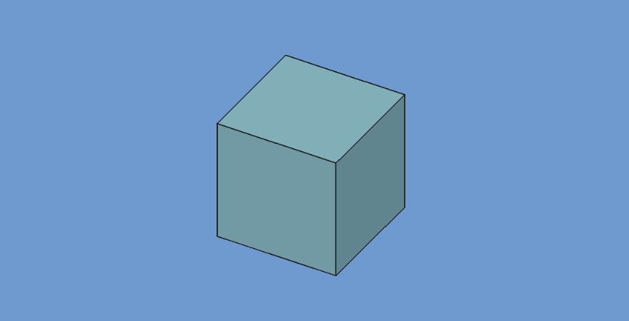

<!-- SPDX-License-Identifier: LGPL-3.0-or-later -->
<!-- SPDX-FileNotice: Part of the CTform FreeCAD Interface addon. -->

# CTform FreeCAD Interface

The **CTform** workbench provides a FreeCAD interface for preparing forging
simulation inputs and visualizing results produced by CTform Core.

## Requirements

CTform Core is a separate proprietary application. It is not included with this
addon and must be installed and licensed separately.

## What it provides

The workbench is intended to bring model preparation, material attribution,
meshing, simulation job setup, and result visualization into the FreeCAD
environment.

The available workflows depend on the installed CTform Core version and the
integration features implemented by this addon.

## Licensing

The addon source is licensed under LGPL-3.0-or-later. CTform Core is governed by
its own license and is outside the distribution of this addon. CTform logos and
other protected assets are covered by the separate asset license.
